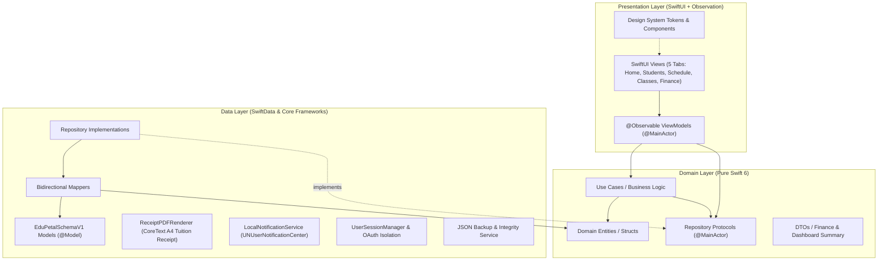
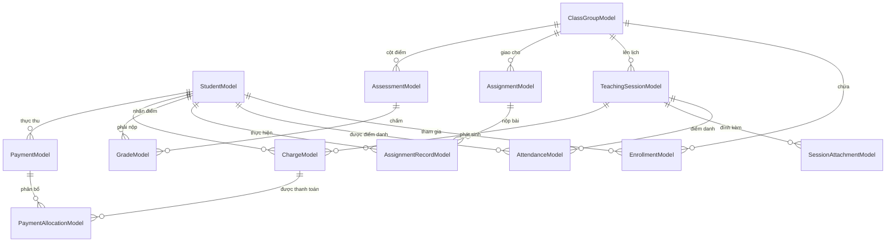

# EduPetal — Architecture & Technical Specifications

> Tài liệu kỹ thuật chi tiết về Kiến trúc phần mềm, Thiết kế Cơ sở dữ liệu, Mô hình Luồng dữ liệu và Nguyên lý Bất biến của **EduPetal** ("Where Teaching Blossoms").

---

## 1. TỔNG QUAN KIẾN TRÚC (ARCHITECTURAL OVERVIEW)

EduPetal tuân thủ nghiêm ngặt mô hình **Clean Architecture kết hợp MVVM** (Model-View-ViewModel) với luồng phụ thuộc một chiều hướng vào tâm (**Dependency Inversion Principle**):

### Các nguyên tắc thiết kế bất biến:
1. **Domain Layer hoàn toàn độc lập:** Không import `SwiftUI`, `SwiftData`, `UIKit` hay bất kỳ thư viện giao diện nào. Tầng Domain là mã Swift thuần 100%, bảo đảm khả năng Unit Test tức thời.
2. **Swift 6 Strict Concurrency:** Toàn bộ các Repository Protocols, ViewModels và UI-bound operations được phân định rõ ràng với `@MainActor`, trong khi các Entities, DTOs và Use Cases tuân thủ chuẩn `Sendable`.
3. **Mappers trung gian:** Tách biệt tuyệt đối giữa các `@Model` của SwiftData và các `Entity` của Domain thông qua `StudentMapper`, `ClassMapper`, `SessionMapper`, `AssignmentMapper`, `GradeMapper`, `FinanceMapper`.

---

## 2. THIẾT KẾ DỮ LIỆU & SƠ ĐỒ THỰC THỂ (`EduPetalSchemaV1`)

Cơ sở dữ liệu của EduPetal được quản lý bởi **SwiftData Schema V1 (`EduPetalSchemaV1`)**:
- **13 Models hoạt động chính:** `StudentModel`, `ClassGroupModel`, `EnrollmentModel`, `TeachingSessionModel`, `AttendanceModel`, `SessionAttachmentModel`, `AssignmentModel`, `AssignmentRecordModel`, `AssessmentModel`, `GradeModel`, `ChargeModel`, `PaymentModel`, `PaymentAllocationModel`.
- **5 Models tương thích ngược (Passive Legacy Migration Models):** `QuestionModel`, `AnswerOptionModel`, `ExamModel`, `ExamQuestionModel`, `ExamResultModel` — được giữ thụ động trong `EduPetalSchemaV1.models` để cơ sở dữ liệu hiện có trên thiết bị người dùng mở an toàn mà không bao giờ bị reset database.

### Chi tiết Delete Rules & Bảo toàn Lịch sử:
- `StudentModel` & `ClassGroupModel` $\rightarrow$ `EnrollmentModel`: `.cascade` (Khi xóa lớp hoặc học sinh, bản ghi ghi danh bị xóa).
- `TeachingSessionModel` $\rightarrow$ `AttendanceModel`: `.cascade` (Xóa buổi học chưa diễn ra sẽ xóa danh sách điểm danh tạm của buổi đó).
- `TeachingSessionModel` $\rightarrow$ `ChargeModel`: `.nullify` (Tuyệt đối không xóa lịch sử học phí).
- **Bảo vệ lịch sử khi xóa lớp (`ClassListViewModel.executeDeleteClass`):** Khi xóa một lớp học, chỉ xóa các buổi chưa diễn ra (`scheduled` / `cancelled`), **giữ nguyên toàn bộ các buổi đã hoàn thành (`completed`) và dữ liệu học phí/thanh toán**.

---

## 3. CÁC NGUYÊN LÝ NGHIỆP VỤ CỐT LÕI (CORE INVARIANTS)

### A. Phương trình Tài chính Đơn nhất (Single-Source Finance)
EduPetal giải quyết triệt để sự mâu thuẫn giữa việc theo dõi học phí học sinh và doanh thu của giáo viên:
$$\mathbf{Accrued\ Tuition} - \mathbf{Collected\ Tuition} = \mathbf{Outstanding\ Balance}$$

- **Đơn vị tiền tệ:** Bắt buộc sử dụng `Int64` cho tiền tệ VND, không dùng `Double` để tránh sai số thập phân IEEE-754.
- **Chưa hoàn thành chưa tính tiền:** Việc thêm học sinh vào lớp hoặc tạo lịch học theo tháng không phát sinh bất kỳ khoản thu nào.
- **Snapshot đơn giá:** Tại thời điểm hoàn thành buổi dạy, hệ thống snapshot đơn giá áp dụng của học sinh (`unitPriceSnapshot`). Nếu giáo viên tăng/giảm học phí lớp hoặc học sinh sau này, toàn bộ các khoản nợ và khoản đã thu trong quá khứ không bị ảnh hưởng.
- **Tính Idempotent:** Khi giáo viên bấm nút Hoàn thành buổi học nhiều lần, `GenerateSessionChargesUseCase` kiểm tra `(sessionId, studentId)` và chỉ tạo bản ghi nợ đúng 1 lần duy nhất.
- **Phân bổ nợ FIFO / Chọn buổi:** Khoản thanh toán mới thu từ học sinh được phân bổ chính xác vào các buổi được chọn hoặc theo thứ tự FIFO, tự động chuyển trạng thái từ `unpaid` $\rightarrow$ `partiallyPaid` $\rightarrow$ `paid`.
- **Chặn thu nợ thừa:** Nghiêm cấm ghi nhận số tiền thanh toán vượt quá dư nợ thực tế ($\text{amount} \le \text{outstandingBalance}$).

### B. Hệ thống Thông báo Nhắc lịch Cục bộ (`LocalNotificationService`)
1. **Hai loại lời nhắc độc lập:**
   - **Loại A:** Nhắc trước buổi dạy 60 phút (`UNCalendarNotificationTrigger` một lần theo ngày giờ thực tế của buổi dạy).
   - **Loại B:** Nhắc xem/thêm lịch dạy hằng ngày (mặc định `22:00`, cho phép chỉnh giờ và thay thế thông báo cũ cùng identifier, không tạo trùng).
2. **Hiển thị Foreground & Điều hướng Deep-Link:** `UNUserNotificationCenterDelegate` hiển thị `.banner, .list, .sound` ngay cả khi ứng dụng đang mở; chạm thông báo tự động chuyển tab sang **Lịch dạy** và mở đúng **Chi tiết buổi học**.
3. **Cô lập theo Tài khoản & Giới hạn iOS:** Khi đổi tài khoản hoặc đăng xuất, hủy toàn bộ thông báo của user cũ để không lộ tên lớp/học sinh; tự động chọn tối đa 48 buổi dạy sắp tới gần nhất để luôn nằm trong giới hạn 64 thông báo chờ của iOS.

### C. Kết xuất Biên nhận Học phí PDF A4 (`ReceiptPDFRenderer`)
- Khổ giấy A4 chuẩn quốc tế: $595.2 \times 841.8\ \text{pt}$.
- Kết xuất trực tiếp qua `CGContext` & `CoreText` hỗ trợ đầy đủ tiếng Việt Unicode có dấu, bảng kê chi tiết từng buổi học thanh toán, tổng tiền đã thu và snapshot dư nợ còn lại.

---

## 4. BẢNG THỐNG KÊ TEST SUITE TỰ ĐỘNG (139 TESTS — 100% PASS)

Dự án sở hữu **139 unit tests và integration tests** thực thi qua **Swift Testing**:

| Test Suite | Số lượng Test | Trọng tâm kiểm thử |
| :--- | :---: | :--- |
| `ScheduleTests` | **45** | Kiểm tra trùng lịch, chuỗi lịch lặp, điểm danh, hoàn thành buổi dạy, thông báo nhắc 60 phút & 22:00 hằng ngày, cô lập thông báo khi đổi user |
| `StudentClassTests` | **29** | CRUD Học sinh & Lớp học, ghi danh 0đ phát sinh, thiết lập lịch theo tháng, học phí theo lớp, lưu trữ & bảo vệ lịch sử tài chính khi xóa lớp |
| `FinanceTests` | **22** | Idempotent Charge, Snapshot đơn giá, Phân bổ FIFO/chọn buổi, chặn thu thừa, VietQR, Biên nhận PDF A4 |
| `AssignmentGradeTests` | **11** | Quản lý bài tập, Validation $0 \le \text{score} \le \text{maxScore}$, Điểm trung bình trọng số |
| `IntegrationWorkflowTests` | **11** | 6 E2E Workflows: Vòng đời Lớp học $\rightarrow$ Lịch tháng $\rightarrow$ Điểm danh $\rightarrow$ Học phí, Backup JSON, OAuth Google/Apple, cô lập đa user và chống Deadlock `0x8BADF00D` |
| `DesignSystemTests` | **9** | Semantic Tokens, Spacing, Radius, Format tiền VND `Int64`, Component states |
| `DashboardTests` | **7** | Chỉ số KPI màn hình Tổng quan, lọc active, luồng hướng dẫn khởi đầu 3 bước (`FirstTimeSetupStep`) |
| `ColorHexTests` | **5** | Khởi tạo màu từ chuỗi Hex 3/6/8 ký tự và fallback an toàn |
| **TỔNG CỘNG** | **139 TESTS** | **100% PASS (8 Test Suites)** |
