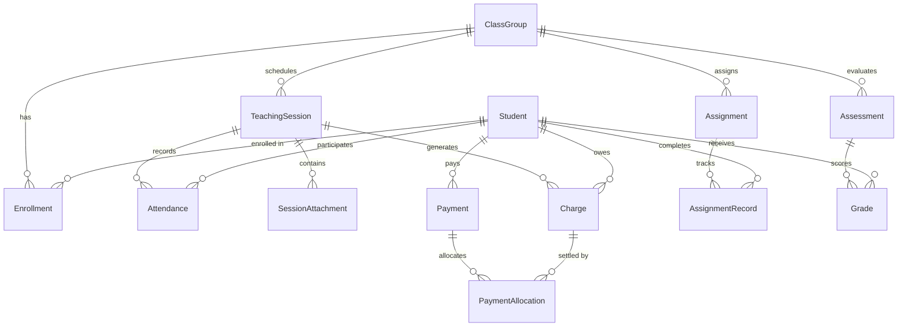

# EDUPETAL — FUNCTIONAL & TECHNICAL SPECIFICATION (SPEC.md)

**App Name:** EduPetal  
**Tagline:** Where Teaching Blossoms  
**Target Platform:** iOS 17.0+ (iPhone primary)  
**Architecture:** Clean Architecture + MVVM (SwiftUI, SwiftData, Swift Testing)  
**Version:** 1.0.0 (MVP)  
**Author:** Principal iOS Architect & Lead SwiftUI Designer  
**Date:** November 2026  

---

## 1. PRODUCT VISION & SCOPE

### 1.1 Sứ mệnh & Định vị sản phẩm
EduPetal là trợ lý quản lý giảng dạy độc lập (All-in-one Teaching OS) trên iPhone dành riêng cho giáo viên tự do và gia sư cá nhân. Ứng dụng giải quyết triệt để sự phân mảnh giữa ghi chép lớp học, học sinh, điểm danh, lịch dạy và đối soát học phí, mang lại trải nghiệm tinh tế, nhanh gọn và an toàn bảo mật tuyệt đối trên thiết bị (Offline-First / On-Device).

### 1.2 User Persona
- **Đối tượng duy nhất:** Giáo viên, gia sư dạy kèm cá nhân hoặc nhóm nhỏ (5–30 học sinh/lớp).
- **Thiết bị:** iPhone cá nhân (ưu tiên thao tác 1 tay, nhanh chóng giữa các buổi dạy).
- **Hành vi cốt lõi:** Tạo lớp học nhanh, thêm học sinh, thiết lập lịch theo tháng, điểm danh trong 10 giây, nhận thông báo nhắc buổi dạy trước 60 phút và nhắc lịch lúc 22:00 hằng ngày, ghi nhận học phí và xuất biên nhận PDF minh bạch.

### 1.3 Scope Boundary (Phạm vi sản phẩm hiện tại)

#### In-Scope (5 Tab điều hướng chính):
1. **Tab 1 — Tổng quan (Home):** Hướng dẫn khởi đầu 3 bước cho người mới (`1. Tạo lớp` → `2. Thêm học sinh` → `3. Lên lịch buổi đầu`), tổng quan 3 chỉ số KPI, lịch dạy hôm nay, việc cần chú ý, quick actions.
2. **Tab 2 — Học sinh (Students):** Hồ sơ học sinh, thông tin liên lạc, đơn giá cá nhân, danh sách lớp đang tham gia hiển thị trực tiếp trên thẻ học sinh, lịch sử đa chiều, lưu trữ (`Archive`) và xóa an toàn.
3. **Tab 3 — Lịch dạy (Schedule):** Lịch ngày/tuần/tháng, tạo/hủy buổi học, thiết lập lịch lặp, kiểm tra trùng lịch (`Overlap Check`), điểm danh snapshot, quy trình hoàn thành buổi học (`Complete Session`) tự động sinh học phí idempotent, nhắc nhở thông báo cục bộ.
4. **Tab 4 — Lớp học (Classes):** Danh sách lớp học (tên lớp, môn học, số học sinh, buổi dạy tiếp theo, đơn giá mặc định, 16 màu nhận diện lớp), chi tiết lớp 4 phân khu (`Tổng quan`, `Học sinh`, `Lịch dạy`, `Học phí`), thêm học sinh có sẵn hoặc tạo mới, thiết lập lịch theo tháng, lưu trữ/khôi phục lớp không làm mất dữ liệu lịch sử tài chính.
5. **Tab 5 — Học phí (Finance):** Single-Source Model với 3 chỉ số (`Accrued Tuition`, `Collected Tuition`, `Outstanding Balance`), đơn vị tiền `Int64` VND, thanh toán linh hoạt từng phần (`Partial Payment`), phân bổ thanh toán (`PaymentAllocation`), mã VietQR và Biên nhận học phí PDF A4.

#### Out-of-Scope (Tuyệt đối không xây dựng / Đã gỡ bỏ):
- **Tính năng Đề thi & Ngân hàng câu hỏi** (Đã gỡ bỏ hoàn toàn khỏi sản phẩm và điều hướng; chỉ giữ các model `@Model` thụ động trong `EduPetalSchemaV1` để tương thích ngược cơ sở dữ liệu SwiftData cũ, không reset DB).
- Tài khoản học sinh/phụ huynh, Parent/Student Portal.
- Học trực tuyến, Video Call, Livestream.
- Học sinh làm bài trực tuyến trong app.
- Hệ thống lương/tiền công độc lập (Học phí = Tiền công của giáo viên, không chia tách).
- Thanh toán online qua cổng ngân hàng (chỉ ghi nhận thủ công + mã QR chuyển khoản).
- Tính học phí theo giờ.
- Tiền thừa/trả trước (Overpayment/Credit balance).

---

## 2. NỀN TẢNG KỸ THUẬT & QUY CHUẨN

| Thành phần | Đặc tả kỹ thuật |
| :--- | :--- |
| **OS Target** | iOS 17.0+ |
| **Language** | Swift 6.2 (Strict Concurrency, `@MainActor`, `Sendable`) |
| **UI Framework** | SwiftUI (Observation Framework với `@Observable`) |
| **Persistence** | SwiftData (`@Model`, `ModelContainer`, `ModelContext`, `VersionedSchema`) |
| **Charts** | Swift Charts |
| **Document/PDF** | PDFKit & CoreGraphics (A4 Layout Renderer) |
| **Test Framework** | Swift Testing (`@Suite`, `@Test`, `#expect`) kết hợp XCTest/XCUITest |
| **Asset Storage** | File Storage cục bộ (`Application Support/Media/`), chỉ lưu URI trong SwiftData |
| **Monetary Unit** | `Int64` VND (Không bao giờ sử dụng `Double`/`Float` cho tiền tệ) |

---

## 3. UI/UX DESIGN SYSTEM — "SOFT PINK EDUCATION"

### 3.1 Triết lý thiết kế
Mang lại sự nhẹ nhàng, tinh tế, truyền cảm hứng ("Where Teaching Blossoms"), đạt tiêu chuẩn thẩm mỹ Apple Design Awards: bố cục thoáng đãng, bo góc mềm mại, đổ bóng tự nhiên, typography rõ ràng, hỗ trợ đầy đủ Dark Mode và Dynamic Type.

### 3.2 Semantic Color Tokens

| Token | Light Mode Hex | Dark Mode Hex | Ý nghĩa sử dụng |
| :--- | :--- | :--- | :--- |
| `primaryPink` | `#E88FA8` | `#E88FA8` | Màu thương hiệu chủ đạo, CTA nổi bật |
| `secondaryPink` | `#F8DCE5` | `#3D2630` | Nền phụ, thẻ phụ, thanh tiến trình |
| `accentRose` | `#B84D73` | `#D67094` | Điểm nhấn icon, tiêu đề phụ, highlight |
| `background` | `#FFF8FA` | `#1C1619` | Màu nền chính toàn app |
| `surfaceCard` | `#FFFFFF` | `#282024` | Nền thẻ (Card), ô nhập liệu, modal |
| `primaryText` | `#392D33` | `#F5EEF0` | Chữ chính, độ tương phản cao |
| `secondaryText` | `#7A6A71` | `#B0A2A8` | Chữ phụ, ghi chú, placeholder |
| `success` | `#27B48B` | `#27B48B` | Thành công, có mặt (`Present`), đã thanh toán |
| `warning` | `#E69F00` | `#E69F00` | Đang chờ, nợ học phí, sắp đến hạn |
| `error` | `#D9534F` | `#D9534F` | Lỗi, vắng mặt (`Absent`), quá hạn |

### 3.3 Typography & Spacing System
- **Font:** SF Pro (Apple System Font), hỗ trợ Dynamic Type (từ `.caption2` đến `.largeTitle`).
- **Spacing Scale:** 4pt (2xs), 8pt (xs), 12pt (sm), 16pt (md), 24pt (lg), 32pt (xl).
- **Corner Radii:** 8pt (small tag), 12pt (button/card standard), 16pt (large card), 24pt (sheet modal).
- **Elevation / Shadows:** Soft blur (radius: 8pt, y: 2pt, color: `Color.black.opacity(0.04)`).

### 3.4 Reusable Components (`Core/DesignSystem/`)
- `PrimaryButton`: Hỗ trợ normal, pressed, disabled, loading.
- `SecondaryButton`: Viền pastel hoặc nền mờ.
- `AppCard`: Thẻ bo góc chuẩn với hiệu ứng bóng nhẹ và dynamic background.
- `StatusBadge`: Huy hiệu trạng thái điểm danh, bài tập, học phí (Present, Absent, Graded, Paid...).
- `EmptyStateView`: Trực quan hóa khi chưa có dữ liệu kèm nút hành động.
- `ErrorStateView`: Thông báo lỗi và nút thử lại (Retry).
- `CurrencyTextField`: Ô nhập tiền tệ tự động format dấu phân cách hàng nghìn (VND).

---

## 4. QUY TẮC BẤT BIẾN NGHIỆP VỤ & TÀI CHÍNH (INVARIANT RULES)

### 4.1 Quy tắc Tài chính Đơn nguồn (Single-Source Finance Rules)
1. **Một dòng tiền duy nhất:** Học phí học sinh trả = Tiền thu nhập của giáo viên. Không quản lý 2 sổ quỹ riêng biệt.
2. **3 Chỉ số bất biến:**
   - $\text{Accrued Tuition} = \sum \text{Charge.amount}$ (Các buổi học đã hoàn thành).
   - $\text{Collected Tuition} = \sum \text{Payment.amount}$ (Các khoản tiền giáo viên đã thực thu).
   - $\text{Outstanding Balance} = \text{Accrued Tuition} - \text{Collected Tuition}$.
3. **Chỉ tính theo buổi:**
   - Học sinh có mặt (`Present`): Phát sinh 1 khoản `Charge` bằng đơn giá snapshot.
   - Học sinh vắng (`Absent`): Phát sinh `Charge` với giá trị `0 VND` (hoặc không tính phí).
   - Buổi `Scheduled` / `Cancelled`: Tuyệt đối không phát sinh `Charge`.
4. **Snapshot Đơn giá:** Khi hoàn thành buổi học, đơn giá tại thời điểm đó được ghi vĩnh viễn vào `Charge.unitPriceSnapshot`. Việc thay đổi học phí của lớp/học sinh sau này không ảnh hưởng đến quá khứ.
5. **Idempotency (Chống tạo trùng):** Việc ấn `Complete Session` nhiều lần hoặc lỗi mạng/ứng dụng không bao giờ được tạo 2 khoản `Charge` cho cùng một `(teachingSessionId, studentId)`.
6. **Thanh toán từng phần:** `Payment` được phân bổ vào các `Charge` thông qua `PaymentAllocation`. Tổng phân bổ không được vượt quá số tiền thanh toán, và tổng thanh toán của 1 `Charge` không được vượt quá `Charge.amount`.

### 4.2 Quy tắc Điểm danh & Snapshot Lớp học (Attendance & Session Snapshot)
1. **Thành viên buổi học là bất biến sau khi hoàn thành:** `Attendance` gắn cố định với `TeachingSession`. Nếu sau này học sinh rời lớp hoặc bị Archive, bản ghi `Attendance` trong quá khứ vẫn giữ nguyên vẹn.
2. **Xác nhận 100% trước khi hoàn thành:** Không cho phép chuyển trạng thái buổi học sang `Completed` nếu còn học sinh ở trạng thái `Pending`/`Unmarked`.
3. **Trạng thái hợp lệ:** `Present`, `Absent`, `ExcusedAbsent` (vắng có phép, 0 VND).

### 4.3 Quy tắc Quản lý Lớp học, Thông báo & Cô lập Đa người dùng
1. **Tạo lớp & Ghi danh học sinh:** Tạo lớp bắt buộc tên lớp và đơn giá hợp lệ ($> 0$), thông tin bổ sung (môn học, thời lượng, 16 màu nhận diện lớp) hiển thị sẵn. Ghi danh học sinh vào lớp hoặc thiết lập lịch học theo tháng **chưa phát sinh tiền**.
2. **Lưu trữ & Bảo vệ lịch sử:** Khi lưu trữ (`Archive`) hoặc xóa lớp học, tuyệt đối không cascade xóa các buổi dạy đã hoàn thành (`completed`) hoặc các bản ghi tài chính (`Charge`, `Payment`).
3. **Thông báo nhắc lịch (`LocalNotificationService`):**
   - Hai loại lời nhắc độc lập: (A) Nhắc trước buổi dạy 60 phút và (B) Nhắc xem/thêm lịch dạy lúc 22:00 hằng ngày (cho phép đổi giờ và thay thế thông báo cũ không tạo trùng).
   - Chỉ báo đã lên lịch sau khi `UNUserNotificationCenter.add` thành công; chạm thông báo mở đúng màn hình Lịch dạy hoặc Chi tiết buổi học.
4. **Cô lập dữ liệu theo tài khoản (`ownerId`):** Mọi bản ghi SwiftData và tệp cục bộ (ảnh minh chứng, avatar) đều gắn `ownerId`. Khi chuyển tài khoản, hủy toàn bộ thông báo chờ của tài khoản cũ và không lộ dữ liệu sang tài khoản mới.

---

## 5. KIẾN TRÚC SWIFTDATA & ERD (`EduPetalSchemaV1`)

### 5.1 Danh sách Models trong `EduPetalSchemaV1`
#### A. 13 Models Hoạt động Chính (Active Models):
1. `Student`: Hồ sơ học sinh (`ownerId`).
2. `ClassGroup`: Lớp học (`colorHex`, `defaultPricePerSession`, `ownerId`).
3. `Enrollment`: Quan hệ tham gia lớp học (`isActive`, `enrolledAt`, `leftAt`).
4. `TeachingSession`: Buổi học cụ thể (`startTime`, `endTime`, `status`, `recurrenceGroupId`, `ownerId`).
5. `Attendance`: Điểm danh của từng học sinh trong buổi học (`pending`, `present`, `absent`, `excused`).
6. `SessionAttachment`: Ảnh minh chứng gắn với buổi học (lưu đường dẫn file cô lập theo `ownerId`).
7. `Assignment`: Bài tập được giao theo lớp.
8. `AssignmentRecord`: Bản ghi theo dõi nộp và chấm bài tập của từng học sinh.
9. `Assessment`: Bài đánh giá / cột điểm (`maxScore`, `weight`).
10. `Grade`: Điểm số của học sinh trong bài đánh giá.
11. `Charge`: Khoản học phí phát sinh từ buổi học đã hoàn thành (`unitPriceSnapshot`, `idempotencyKey`).
12. `Payment`: Khoản tiền thực thu từ học sinh/phụ huynh (`receiptNumber`, `remainingBalanceSnapshot`).
13. `PaymentAllocation`: Bản ghi phân bổ số tiền thanh toán cho từng khoản nợ học phí (`Charge`).

#### B. 5 Models Tương thích Ngược Schema V1 (Passive Legacy Migration Models):
- `QuestionModel`, `AnswerOptionModel`, `ExamModel`, `ExamQuestionModel`, `ExamResultModel`: Chỉ giữ thụ động trong `EduPetalSchemaV1.models` để các cơ sở dữ liệu SQLite đã lưu từ phiên bản trước trên iPhone mở bình thường mà không cần reset database (tính năng Đề thi đã ngừng hoạt động hoàn toàn).

### 5.2 Sơ đồ Quan hệ Thực thể Hoạt động (Active ERD)



### 5.3 Chi tiết Entity & Delete Rules

| Entity | Primary Key | Key Attributes | Relationships & Delete Rule |
| :--- | :--- | :--- | :--- |
| `Student` | `id: UUID` | `fullName`, `phoneNumber`, `parentPhone`, `email`, `defaultPricePerSession: Int64?`, `isArchived: Bool`, `ownerId` | `enrollments` (.cascade), `attendances` (.nullify), `charges` (.nullify), `payments` (.nullify), `grades` (.cascade), `assignmentRecords` (.cascade) |
| `ClassGroup` | `id: UUID` | `name`, `subject`, `defaultPricePerSession: Int64`, `sessionDurationMinutes: Int`, `colorHex`, `isArchived: Bool`, `ownerId` | `enrollments` (.cascade), `sessions` (.nullify — bảo vệ buổi đã hoàn thành), `assignments` (.cascade), `assessments` (.cascade) |
| `Enrollment` | `id: UUID` | `studentId`, `classId`, `enrolledAt`, `leftAt: Date?`, `isActive: Bool` | `student` (.nullify), `classGroup` (.nullify) |
| `TeachingSession` | `id: UUID` | `classId`, `title`, `startTime`, `endTime`, `status: SessionStatus`, `lessonNotes`, `ownerId` | `attendances` (.cascade), `attachments` (.cascade), `charges` (.nullify), `classGroup` (.nullify) |
| `Attendance` | `id: UUID` | `sessionId`, `studentId`, `status: AttendanceStatus` (pending, present, absent, excused), `note` | `session` (.nullify), `student` (.nullify) |
| `SessionAttachment` | `id: UUID` | `sessionId`, `filePath: String`, `fileType: String`, `caption: String?`, `createdAt` | `session` (.nullify) |
| `Assignment` | `id: UUID` | `classId`, `title`, `descriptionText`, `dueDate`, `maxScore: Double`, `ownerId` | `records` (.cascade), `classGroup` (.nullify) |
| `AssignmentRecord`| `id: UUID` | `assignmentId`, `studentId`, `status: AssignmentStatus`, `score: Double?`, `feedback` | `assignment` (.nullify), `student` (.nullify) |
| `Assessment` | `id: UUID` | `classId`, `title`, `maxScore: Double`, `weight: Double`, `date: Date`, `ownerId` | `grades` (.cascade), `classGroup` (.nullify) |
| `Grade` | `id: UUID` | `assessmentId`, `studentId`, `score: Double`, `notes: String?` | `assessment` (.nullify), `student` (.nullify) |
| `Charge` | `id: UUID` | `sessionId: UUID`, `studentId: UUID`, `amount: Int64`, `unitPriceSnapshot: Int64`, `status: ChargeStatus`, `ownerId` | `session` (.nullify), `student` (.nullify), `allocations` (.cascade) |
| `Payment` | `id: UUID` | `studentId: UUID`, `amount: Int64`, `paidAt: Date`, `note: String?`, `paymentMethod: String`, `ownerId` | `student` (.nullify), `allocations` (.cascade) |
| `PaymentAllocation`| `id: UUID` | `paymentId: UUID`, `chargeId: UUID`, `allocatedAmount: Int64`, `allocatedAt: Date` | `payment` (.nullify), `charge` (.nullify) |

---

## 6. CLEAN ARCHITECTURE + MVVM PATTERN

```
[ Presentation Layer ] (SwiftUI + @Observable ViewModels + UI State)
       │
       ▼ (Uses DTO / Domain Entities)
[ Domain Layer ] (Pure Swift: UseCases, Repository Protocols, Domain Models)
       ▲
       │ (Implements Repositories via Mappers)
[ Data Layer ] (SwiftData Models @Model, SwiftDataRepositories, FileStorage, PDFKit)
```

- **Quy tắc phụ thuộc:** Domain Layer hoàn toàn độc lập, không import SwiftUI hay SwiftData.
- **Concurrency & Threading:** Toàn bộ ViewModels và UI State hoạt động trên `@MainActor`. Thao tác SwiftData sử dụng `ModelContainer` chia sẻ hoặc background context cô lập khi xử lý dữ liệu nặng.
- **Repository Pattern:** Mỗi feature giao tiếp qua Protocol (ví dụ: `StudentRepositoryProtocol`, `FinanceRepositoryProtocol`), cho phép khởi tạo Mock Repository phục vụ Unit Test tức thì mà không cần database disk.

